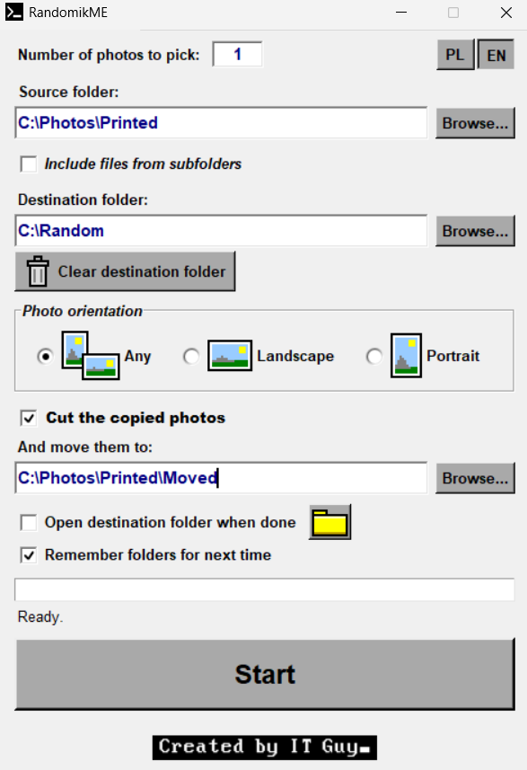

# Randomik

**Randomly pick photos from a big collection, copy them to another folder, and never get the same ones twice.**



## Why I made it

At home we have a board where we hang freshly printed photos. Once a month we swap them for new ones. I keep digital copies of all the prints on my computer, and I wanted the choice to be truly random: not the same few photos over and over, and not me picking them by hand every time.

So I wrote Randomik. You tell it how many photos you need and where to put them. It draws them at random from the whole collection and **copies** them into a separate folder, so the main collection stays untouched. Optionally it also **moves the drawn originals aside** into a "used" subfolder. Next month those photos can't be drawn again, and every photo gets its turn on the board.

Need only portrait photos for a tall frame, or only landscape ones? There's a filter for that too.

## Features

- **Random draw**: choose how many photos to pick (default: 1).
- **Copy, not move**: originals stay where they are by default. Copies keep their original file dates.
- **"Cut the copied photos"**: after copying, the originals are moved to a folder of your choice, so they don't take part in the next draw.
- **Orientation filter**: *Any*, *Landscape* or *Portrait*. The program respects the EXIF rotation, so phone photos stored "sideways" are classified the way you actually see them. Square photos count as landscape.
- **Include subfolders**: optionally search the whole folder tree. This can take longer on huge collections. The destination and "used" folders are never searched, even if they sit inside the source folder.
- **No overwriting**: if a file with the same name already exists in the target folder, the new one becomes `name (1).jpg`, `name (2).jpg`, and so on.
- **Safe by design**: everything is validated before the first file is touched. If there aren't enough matching photos, you get a message and nothing is copied or moved.
- **Clear destination folder**: one click empties the folder from last time (with a confirmation, files only, subfolders untouched). It refuses to clear a drive root or your source / "used" folder.
- **Open destination folder**: a button for opening the result right away, plus an option to open it automatically when the draw is done.
- **Remember folders**: tick the checkbox and your paths are restored next time. Leave it unticked and the program starts with empty fields.
- **English / Polish interface**: starts in English, and your choice is remembered.
- **Doesn't freeze**: the work runs in the background with a progress bar.
- **Retro look**: a classic Windows 9x-style interface with pixel-art icons.

Supported file types: `jpg`, `jpeg`, `png`, `gif`, `bmp`, `tiff`, `webp`, `ico`, `tga`, `psd`, `svg`, `eps`, `ai`, `pdf`, `raw`, `nef`, `cr2`, `wmf`, `emf`, `exr`.
The orientation filter needs the image size, so it works for formats the Pillow library can open (JPG, PNG, WebP, TIFF, BMP, GIF and similar). Other formats from the list (e.g. RAW) are only picked with orientation set to *Any*.

## How to use it

1. Enter the **number of photos** you want.
2. Choose the **source folder** (your photo collection).
3. Choose the **destination folder** (where the drawn photos will be copied).
4. Optionally tick **Include files from subfolders**, and pick an **orientation**.
5. Optionally tick **Cut the copied photos** and choose the folder the originals should be moved to. If this folder is inside your source folder, it's automatically skipped in the next draw.
6. Press **Start**.

Tip for the monthly swap: press **Clear destination folder** first to remove last month's photos, then draw new ones.

## Running it

**Option 1: the exe (Windows).** Download `RandomikME.exe` from the [Releases](../../releases) page and run it. No installation needed.

**Option 2: from source.** You need Python 3 with Tkinter (included in the standard Windows installer) and Pillow:

```
pip install -r requirements.txt
python Randomik.py
```

Keep `favicon2.ico` and `created.png` next to the script. Without them the program still works, just without the icon and the badge.

The program was developed and tested on Windows.

## Building the exe yourself

With [Nuitka](https://nuitka.net/):

```
pip install nuitka pillow
python -m nuitka --onefile --enable-plugin=tk-inter --windows-console-mode=disable --windows-icon-from-ico=favicon2.ico --include-data-files=favicon2.ico=favicon2.ico --include-data-files=created.png=created.png --assume-yes-for-downloads --output-filename=RandomikME.exe Randomik.py
```

Or with PyInstaller:

```
pip install pyinstaller pillow
pyinstaller --onefile --noconsole --icon=favicon2.ico --add-data "favicon2.ico;." --add-data "created.png;." --name RandomikME Randomik.py
```

Unsigned exe files built this way are sometimes flagged by Windows SmartScreen or antivirus software. That's a known false positive for freshly built, unsigned programs; the full source is right here if you'd like to check it or build it yourself.

## Where are the settings?

In `%APPDATA%\RandomikME\settings.json` (language, checkboxes and, only if you tick "Remember folders", the folder paths). Delete that file to reset the program.

## Feedback

Still a beta, and constructive criticism is very welcome. Found a bug or have an idea? Open an [issue](../../issues).
